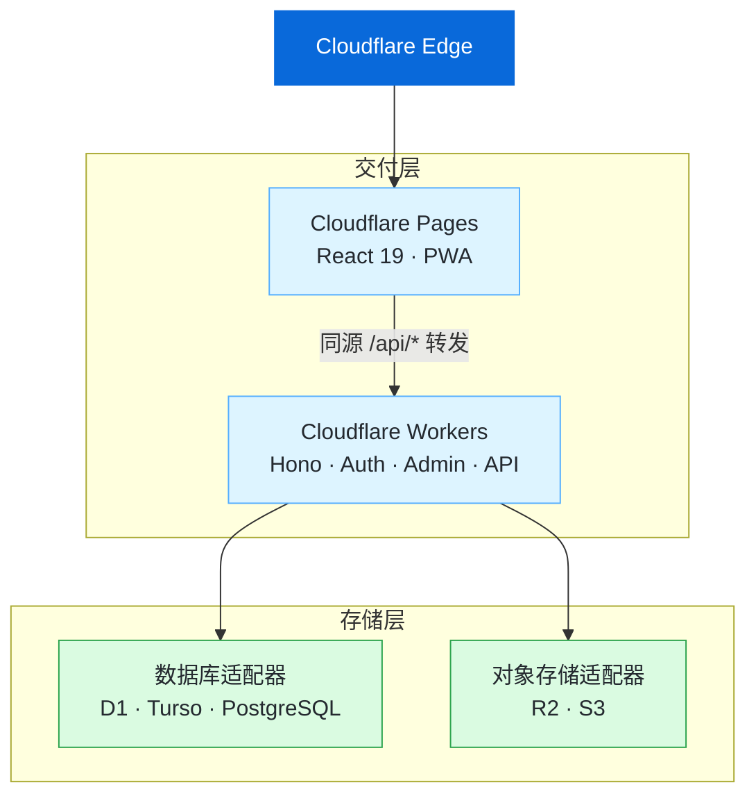

<div align="center">


# Monolith

### 一套真正属于你的边缘原生博客

把写作、阅读、分析与运维，收进一个干净、快速、可控的系统。

<p>
  <a href="https://monolith-client.pages.dev"><strong>访问在线演示 ↗</strong></a>
  ·
  <a href="https://github.com/one-ea/Monolith/wiki">阅读文档</a>
  ·
  <a href="https://github.com/one-ea/Monolith/issues">提交反馈</a>
</p>

<p>
  
  
  
  
  
</p>

</div>

---

## Monolith 是什么？

Monolith 是一个面向个人创作者的全栈博客系统：前端运行在 Cloudflare Pages，API 运行在 Cloudflare Workers，数据与媒体通过可替换的存储适配器连接。

它不试图把你的内容锁进某个 SaaS，而是把博客最重要的部分交还给你：

> **内容归你，配置归你，部署归你，数据也归你。**

默认采用 GitHub Primer 风格的明暗主题，后台统一管理站点行为，日常修改无需重新部署。

## 为什么选择 Monolith？

<table>
<tr>
<td width="33%" valign="top">

### ⚡ Edge-first

基于 Hono、Cloudflare Workers 与 Pages 构建。前后端贴近用户运行，轻量交付，适合全球访问。

</td>
<td width="33%" valign="top">

### 🎛️ Console-driven

主题、安全、SEO、通知、注入片段与分析开关，都可以在控制台集中配置。

</td>
<td width="33%" valign="top">

### 🔓 Portable

数据库与对象存储采用适配器设计，可在 D1、Turso、PostgreSQL 与 R2/S3 之间切换。

</td>
</tr>
</table>

---

## 能做什么

### 写作与内容

- Markdown 编辑与实时预览
- KaTeX 数学公式与代码高亮
- 草稿、定时发布、置顶文章与系列合集
- 独立页面与动态导航
- WordPress、Ghost、Hexo、Hugo、Jekyll、Halo 内容导入
- JSON、R2/S3、WebDAV 多端备份

### 阅读与发现

- GitHub Primer「浅色 - 默认 / 深色 - 默认」视觉语言
- 明暗模式与简洁 / 液态玻璃风格
- 首屏主题预加载，避免闪烁
- 自动目录、阅读进度与章节追踪
- `⌘K` / `Ctrl+K` 全站搜索
- Reaction 轻互动与彩色标签
- PWA 离线能力与响应式布局

### 控制台与运营

| 模块 | 控制能力 |
| --- | --- |
| **安全** | Turnstile 登录保护、JWT 会话时长、登录 / 友链 / 留言限流 |
| **通知** | 多 Webhook、一键测试、Resend 发件人与管理员邮箱 |
| **主题** | 亮色、暗色、跟随系统；简洁与液态玻璃风格 |
| **发现与注入** | 外部脚本、统计服务预设、作用域、位置与 Cookie 同意策略 |
| **SEO** | 站点域名、robots 追加规则、sitemap 归档开关与额外 URL |
| **分析** | D1 轻量统计、Cloudflare Analytics Engine、站点白名单 |

### SEO 与隐私

- `sitemap.xml`、`robots.txt`、RSS 2.0
- JSON-LD、Open Graph、Twitter Card
- Cookie 同意控制与第三方脚本门控
- GDPR 数据导出
- CSP、HSTS、SSRF 防护与参数化 SQL

---

## 架构概览



### 请求与数据流

| 路径 | 作用 |
| --- | --- |
| **访问站点** | 用户 → Cloudflare Edge → Pages，加载 React 应用与 PWA 资源 |
| **调用 API** | Pages Functions 将同源 `/api/*` 请求转发到 Workers，避免跨域配置 |
| **读写数据** | Workers 通过 `IDatabase` 适配器访问 D1、Turso 或 PostgreSQL |
| **处理媒体** | Workers 通过 `IObjectStorage` 适配器访问 R2 或 S3 兼容存储 |
| **变更配置** | 控制台写入 D1 `settings`；凭据与基础设施配置保留在 Workers secret / vars |

### 核心设计

- **存储适配器**：`IDatabase` 与 `IObjectStorage` 统一接口，降低平台耦合。
- **配置分层**：站点行为进入 D1 `settings`，凭据与基础设施配置保留在 Workers secret / vars。
- **同源 API**：Pages Functions 将 `/api/*` 转发到 Workers，减少 CORS 与环境差异。
- **边缘部署**：迁移、schema reconcile、Workers 与 Pages 由一个部署脚本串联完成。
- **安全默认值**：敏感凭据不进入数据库、仓库、日志或前端响应。

> 详细设计请阅读 [Wiki · 架构概览](https://github.com/one-ea/Monolith/wiki/Architecture)。

---

## 快速开始

### 环境要求

- Node.js `>= 22`
- npm
- Cloudflare 账户（部署到 Cloudflare 时需要）

### 本地运行

```bash
git clone https://github.com/one-ea/Monolith.git
cd Monolith

# 使用项目指定的 Node 版本
nvm install && nvm use

# 安装依赖并检查本地环境
npm ci
npm run doctor:local

# 启动前后端开发服务器
npm run dev
```

本地服务启动后，前端与 API 会分别使用开发环境端口。完整的环境变量、数据库初始化与本地存储说明请参阅 [Wiki · 快速开始](https://github.com/one-ea/Monolith/wiki/Quick-Start)。

### 常用命令

| 命令 | 用途 |
| --- | --- |
| `npm run dev` | 同时启动前端与 Workers 开发服务器 |
| `npm run check` | 执行工作区类型检查 |
| `npm run lint` | 执行工作区 ESLint |
| `npm run build` | 构建前端产物 |
| `npm run db:migrate:local` | 执行本地 D1 迁移 |
| `npm run db:reconcile:local` | 对齐本地 D1 schema |
| `npm run deploy:cloudflare` | 执行完整 Cloudflare 部署链路 |

---

## 部署到 Cloudflare

首次部署前登录 Wrangler：

```bash
npx wrangler login
npm run deploy:cloudflare
```

部署脚本会按顺序处理：

```text
远程 D1 migrations
        ↓
D1 schema reconcile
        ↓
Workers 部署
        ↓
Pages API_BASE 注入
        ↓
前端构建与 Pages 部署
        ↓
生产健康检查
```

### 配置边界

**必须保留为 Workers secret 的凭据：**

- `ADMIN_PASSWORD`
- `JWT_SECRET`
- `REACTION_SALT`
- `TURNSTILE_SECRET`
- `RESEND_API_KEY`
- `CLOUDFLARE_API_TOKEN`

**可在控制台维护的站点行为配置：**

- 站点来源、主题、SEO 与 robots / sitemap
- Webhook、Resend 发件人与管理员邮箱
- Turnstile Site Key、限流与 JWT 会话时长
- 注入片段、Cookie 同意策略与 Analytics Engine 设置
- Cloudflare Account ID 等非敏感平台配置

生产环境已有 secret 且本地没有明文时，请遵循 [Wiki · 部署指南](https://github.com/one-ea/Monolith/wiki/Deployment) 中的“不覆盖 secret 分步部署”流程。不要为了部署重新写入或复制生产密钥。

也可以从 GitHub Actions 手动触发 **Cloudflare Deploy** 工作流，工作流会执行相同的分步部署与健康检查。

---

## 文档导航

| 文档 | 内容 |
| --- | --- |
| [Wiki 首页](https://github.com/one-ea/Monolith/wiki) | 项目总览与全部文档 |
| [架构概览](https://github.com/one-ea/Monolith/wiki/Architecture) | 系统边界、数据流与设计决策 |
| [快速开始](https://github.com/one-ea/Monolith/wiki/Quick-Start) | 本地开发、环境与初始化 |
| [部署指南](https://github.com/one-ea/Monolith/wiki/Deployment) | Cloudflare 部署、迁移与排错 |
| [控制台配置](https://github.com/one-ea/Monolith/wiki/Console-Settings) | 设置键、配置优先级与 secret 边界 |
| [前端指南](https://github.com/one-ea/Monolith/wiki/Frontend-Guide) | 主题、组件与页面开发 |
| [安全策略](./SECURITY.md) | 漏洞披露与安全响应 |
| [隐私政策](./PRIVACY.md) | 数据处理与用户权利 |

---

## 贡献

欢迎提交 Issue、改进文档或发起 Pull Request。

在提交代码前，请先：

1. 阅读 [贡献指南](https://github.com/one-ea/Monolith/wiki/Contributing)。
2. 运行 `npm run check`、`npm run lint` 与 `npm run build`。
3. 确认没有将 secret、`.env`、本地上下文或生成文件提交到仓库。

Bug、功能建议与体验反馈请前往 [GitHub Issues](https://github.com/one-ea/Monolith/issues)。

## License

Monolith 基于 [MIT License](./LICENSE) 开源。

<div align="center">

<br />

<sub>Built for writers. Tuned for the edge. ✦</sub>

</div>
